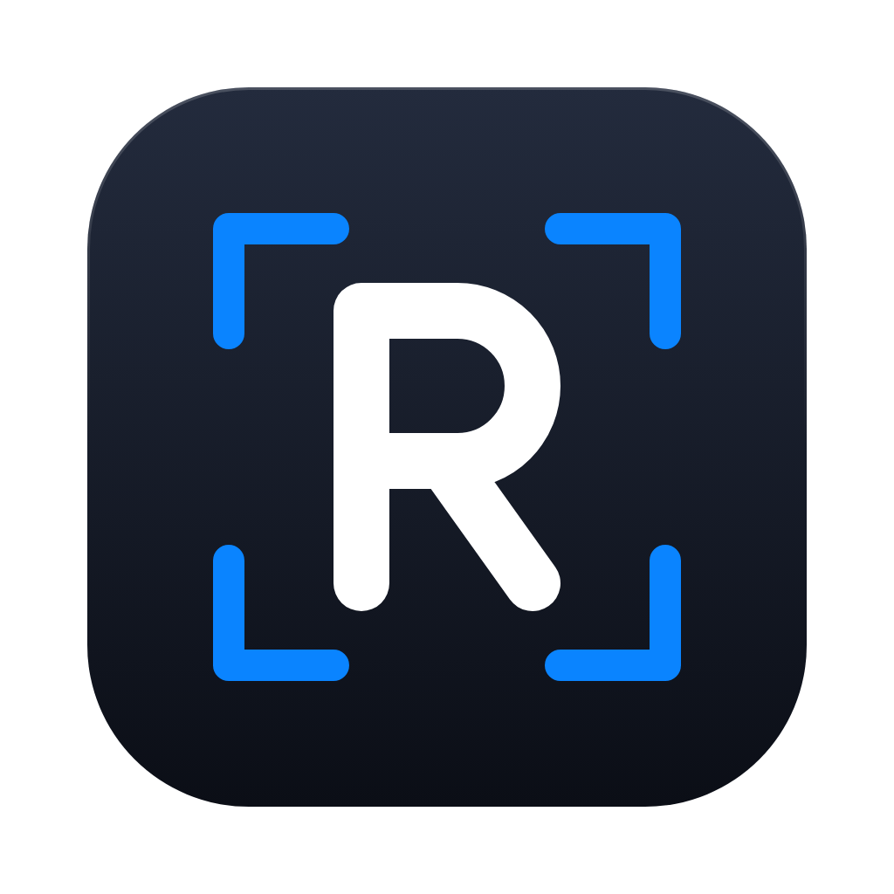
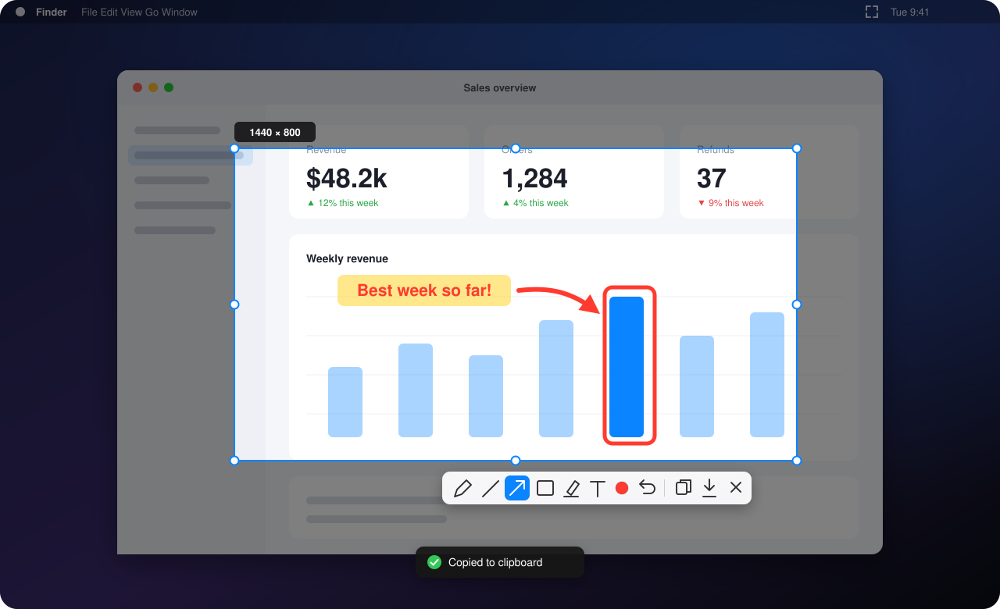

<p align="center">
  
</p>

<h1 align="center">Reshot</h1>

<h3 align="center">Screenshot, mark it up, share it.<br>In about two seconds.</h3>

<p align="center">
  A free screenshot app for Mac, Windows and Linux.<br>
  One shortcut, one drag, and it's on your clipboard.
</p>

<p align="center">
  <a href="https://github.com/tansuasici/Reshot/releases/latest"></a>
  <a href="https://github.com/tansuasici/Reshot/releases/latest"></a>
  <a href="https://github.com/tansuasici/Reshot/releases/latest"></a>
</p>

<p align="center">
  <sub>Free and open source · No account · Nothing leaves your computer</sub>
</p>

<p align="center">
  
</p>

## How it works

|  |  |  |
|:-:|:-:|:-:|
| **1. Press** | **2. Drag** | **3. Done** |
| <kbd>⌘</kbd> <kbd>⇧</kbd> <kbd>9</kbd> on Mac<br><kbd>Ctrl</kbd> <kbd>Shift</kbd> <kbd>9</kbd> on Windows & Linux | Select the part of the screen you want. Add an arrow or a note if you like. | Press <kbd>Enter</kbd>. It's on your clipboard, ready to paste anywhere. |

No editor window to open, no export menu to dig through. Reshot shows up when
you need it and gets out of the way when you're done.

## Everything you need, nothing you don't

<table>
  <tr>
    <td width="33%" valign="top">
      <h4>⚡ Instant</h4>
      The screen freezes the moment you press the shortcut, so menus and
      tooltips stay put while you choose what to capture.
    </td>
    <td width="33%" valign="top">
      <h4>✏️ Mark it up</h4>
      Pen, line, arrow, box, highlighter and text in eight colours. Made a
      mistake? Undo.
    </td>
    <td width="33%" valign="top">
      <h4>📋 Copy or save</h4>
      <kbd>Enter</kbd> copies, <kbd>⌘/Ctrl</kbd> <kbd>S</kbd> saves as PNG
      or JPEG. It remembers the folder you used last.
    </td>
  </tr>
  <tr>
    <td width="33%" valign="top">
      <h4>🎯 Pixel perfect</h4>
      Fine-tune your selection with handles and see its exact size as you
      drag.
    </td>
    <td width="33%" valign="top">
      <h4>🖥️ Sharp on every screen</h4>
      Full Retina and HiDPI quality, on whichever monitor you're using.
    </td>
    <td width="33%" valign="top">
      <h4>🔒 Private by design</h4>
      No account, no cloud and no tracking. Your screenshots stay on your
      computer.
    </td>
  </tr>
</table>

## Get Reshot

Download the file for your computer from the
**[latest release](https://github.com/tansuasici/Reshot/releases/latest)**:

| Your computer | Download |
|---------------|----------|
| Mac with Apple chip (M1 and newer) | `Reshot_…_aarch64.dmg` |
| Mac with Intel chip | `Reshot_…_x64.dmg` |
| Windows | `Reshot_…_x64-setup.exe` |
| Linux | `.AppImage`, `.deb` or `.rpm` |

It's a small download of about 4 MB. Once installed, Reshot sits quietly in
your menu bar or system tray.

## Questions

<details>
<summary><b>Is it really free?</b></summary>
<br>
Yes. Reshot is free and open source under the MIT license. There's no paid
version, no trial and no ads.
</details>

<details>
<summary><b>Does it upload my screenshots anywhere?</b></summary>
<br>
No. Reshot works entirely on your computer. It doesn't need an internet
connection and doesn't send anything anywhere.
</details>

<details>
<summary><b>Why does my Mac ask for "Screen Recording" permission?</b></summary>
<br>
macOS asks this for every app that can see what's on your screen, which is
exactly what a screenshot app does. Allow it once, then quit and reopen
Reshot. Reshot only looks at your screen when you press the shortcut.
</details>

<details>
<summary><b>My computer says it can't verify the app. Is that safe?</b></summary>
<br>
Reshot isn't signed with a paid Apple or Microsoft certificate yet, so your
system asks you to confirm the first time.
<ul>
  <li><b>Mac:</b> open <i>System Settings → Privacy & Security</i> and click <b>Open Anyway</b>.</li>
  <li><b>Windows:</b> click <b>More info → Run anyway</b>.</li>
</ul>
The full source code is right here, so anyone can check what it does.
</details>

<details>
<summary><b>Does it work on Linux with Wayland?</b></summary>
<br>
Yes. On Wayland, Reshot uses your desktop's built-in screenshot service. It
works on X11 too. Whether the tray icon shows up depends on your desktop.
</details>

<details>
<summary><b>What are all the keyboard shortcuts?</b></summary>
<br>

| Key | Action |
|-----|--------|
| <kbd>⌘/Ctrl</kbd> <kbd>⇧</kbd> <kbd>9</kbd> | Take a screenshot |
| <kbd>Enter</kbd> or <kbd>⌘/Ctrl</kbd> <kbd>C</kbd> | Copy (the whole screen if nothing is selected) |
| <kbd>⌘/Ctrl</kbd> <kbd>S</kbd> | Save as PNG or JPEG |
| <kbd>⌘/Ctrl</kbd> <kbd>Z</kbd> | Undo |
| <kbd>P</kbd> <kbd>L</kbd> <kbd>A</kbd> <kbd>R</kbd> <kbd>M</kbd> <kbd>T</kbd> | Pen, line, arrow, rectangle, marker, text |
| <kbd>Esc</kbd> | Cancel |

</details>

---

## For developers

<details>
<summary><b>Build from source</b></summary>
<br>

You need [Rust](https://rustup.rs/) (stable), [Node.js](https://nodejs.org/)
20 or newer, and the
[Tauri prerequisites](https://tauri.app/start/prerequisites/) for your OS.

```bash
git clone https://github.com/tansuasici/Reshot.git
cd Reshot
npm install
npm run tauri dev      # run in development
npm run tauri build    # build installers into src-tauri/target/release/bundle
```

You can also work on the overlay UI in a plain browser with `npx vite`. When
it isn't running inside Tauri, `src/ipc.ts` serves a generated test frame.

Releases are built by GitHub Actions: pushing a `v*` tag builds installers for
every platform and attaches them to a draft GitHub release.

</details>

<details>
<summary><b>How it's built</b></summary>
<br>

Reshot is built with [Tauri 2](https://tauri.app/). The Rust backend uses
[xcap](https://github.com/nashaofu/xcap) for screen capture and
[arboard](https://github.com/1Password/arboard) for the clipboard. The
overlay is framework-free TypeScript on Canvas 2D, and pixels go to and from
it as raw bytes, with no encoding on the hot path.
[CODEBASE_MAP.md](CODEBASE_MAP.md) describes the architecture.

</details>

**Contributing:** bug reports, ideas and pull requests are all welcome. See
[CONTRIBUTING.md](CONTRIBUTING.md) to get started.

<p align="center"><sub><a href="LICENSE">MIT</a> © tansuasici</sub></p>
